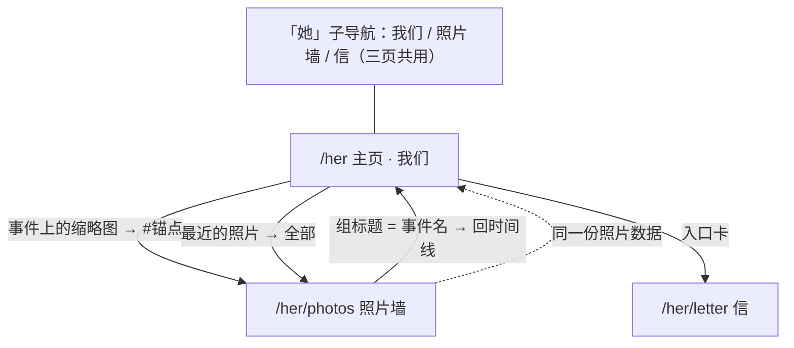

# 「她」· 三页技术路线图与样式规格

> 目标：在现有 lnstinct 博客里，为一个人做三页。内容留空位、日期由小泽填，样式长在现有设计系统里。
> 结构：**主页（我们）+ 照片墙 + 信**，三页共用一份数据。
> 状态：样式图已定稿（`public/mockups/`），实现由 Agent 团队分三层推进中。

---

## 0. 硬约束

| 约束 | 决定 | 原因 |
|---|---|---|
| 公开程度 | **本地自看**：不推送、不进主导航、不进 sitemap，三页都带 `robots: noindex` | 小泽的选择。真实照片与称呼不经过公网 |
| 日期来源 | **只认他给的数字，缺就留空** | 他给的是「1 0月11号」→ 按 10 月 11 日；纪念日没给 → 页面写「待填」，不编 |
| 视觉归属 | **完全复用「纸上生长」色板与排版** | 不做第二套设计，不新增依赖（无 lightbox 库、无日期库） |
| 不代写 | 她的称呼（昵称占位）、纪念日、信的内容 | 规则第 8/30 条：不编造事实 |

---

## 1. 三页结构与互链



**三页的分工**：主页回答「还有多少天、我们经历了什么」，照片墙回答「都有哪些照片」，信回答「我想说什么」。互链不是装饰——它是把一次浏览串成一条路。

页面顺序的依据：第一屏不滚动就能看到天数；照片按事件分组，点事件名能回到时间线；信放在最后，因为它需要一个安静的收尾。

---

## 2. 数据模型：一份数据，两处展示

内容全部在 `src/content/her.ts`（**默认值与回退**）与 `data/her.json`（**后台保存后的真实内容**）。**照片与时间线的绑定是这一节的核心契约。**

数据流向（已实现）：

```
src/content/her.ts  ──默认值──┐
                              ├─→ getHerProfile()  ← 三个公开页读这个
data/her.json ──zod 校验通过──┘         ↑
                                        └── saveHerProfile() ← /admin/her 表单
```

- 文件不存在 / JSON 损坏 / zod 校验不过 → **回退默认内容**，且坏文件**原样保留**（不静默覆盖用户数据）。
- `data/her.json` **不预建**：没保存过就不存在，避免「两份内容谁赢」说不清。

```ts
export const PHOTO_DIR = '/media/her';
/** 三页共用的「还没填」文案，只此一处，别在页面里再写一遍 */
export const DATE_PLACEHOLDER = '待填';

export type HerEvent = {
  readonly id: string;             // ASCII 锚点，如 'page-built'；照片墙点事件名 → /her#page-built，同时当列表 key
  readonly date: string | null;    // 显示用，如 '2026 · 10 · 12'
  readonly iso: string | null;     // 排序 + 倒计时/天数计算用；null = 还没想起来
  readonly title: string;
  readonly note?: string;
  /** 挂在事件上的照片：文件名数组。时间线显示前 1 张缩略图，照片墙按此分组 */
  readonly photos?: readonly string[];
};

export type HerPhoto = {
  readonly file: string;           // '2026-10-12-01.jpg'
  /** 后台上传得到的站内路径（如 '/media/<uuid>.jpg'）。有 src 用 src，没有则退回 PHOTO_DIR + file */
  readonly src?: string;
  readonly caption?: string;       // 可空，空则不占位
  readonly eventIso?: string | null; // 归属事件；null = 未归属，照片墙里单独一组
};

export type HerProfile = {
  readonly slug: 'her';
  readonly displayName: string;    // 昵称占位，真名不出现
  readonly tagline: string;        // Hero 副标题
  readonly heroYear: string;       // Hero 署名年份；断言 = pageBuiltOn 的年份
  readonly pageBuiltOn: string;    // 建页日 '2026-10-12'，「站在这页上的时间」的数字来源
  readonly birthday: { readonly month: number; readonly day: number };
  readonly since: string | null;   // 纪念日；null → 页面显示「待填」
  readonly timeline: readonly HerEvent[];
  readonly photos: readonly HerPhoto[];
  readonly letter: {
    readonly salutation: string;
    readonly paragraphs: readonly string[];
    readonly quote?: string;
    readonly signature?: string;
  };
};
```

派生函数（放在内容文件里，页面只消费，不自己算；签名已按实现定稿）：

| 函数 | 作用 |
|---|---|
| `photoSrc(photo)` | 照片 URL：**有 `src` 用 `src`，否则 `PHOTO_DIR + file`** |
| `eventPhotoFiles(event)` | 事件挂的照片文件名（去重、丢空名） |
| `photosForEvent(event, profile?)` | 该事件下的照片条目（照片墙分组用） |
| `eventOfPhoto(photo, profile?)` | 照片归属的事件（先认 `eventIso`，再认文件名） |
| `photoGroups(profile?)` | 照片墙分组：时间线里每个事件一组，没照片的组为空数组 |
| `recentPhotoEntries(count, profile?)` | 主页「最近的照片」：每个事件露一张，取满 count |
| `unassignedPhotos(profile?)` | 没被任何事件引用的照片（正常应为空，不为空就是数据错） |
| `isLetterEmpty(profile?)` | 信还是空数组 → 页面显示空状态 |

**绑定规则（三条，实现与测试都必须守）**：

1. 时间线上每个事件的缩略图 = 该事件 `photos[0]`；同一文件名在照片墙里出现在**该事件的分组**下。
2. 照片墙的分组标题与图注**从事件字段派生**（`title` / `date` / `caption`），不允许在照片数据里再写一遍同样的文案。
3. 事件的 `photos` 里出现的每个文件，**必须**能在 `photos` 列表里找到，且该文件在磁盘上真实存在（站内路径用 `public + photoSrc(photo)` 定位；`http(s)` 的跳过文件检查）。这条由单元测试守——契约破了就是数据错，不是样式错。`src/domain/her-schemas.ts` 的 zod schema 在**写入前**再挡一层。

锚点约定：照片 `id = 'photo-' + file.replace(/\./g, '-')`（例 `#photo-2026-10-12-01`）；事件 `id` 是 ASCII 短名（例 `#page-built`）。主页缩略图 → `/her/photos#photo-2026-10-12-01`，照片墙组标题 → `/her#page-built`。

**占位照片**：`public/media/her/2026-10-12-01.jpg` 已放好（1200×900 占位图，暖纸底 + 一行说明文字，非真人照、非下载素材），文件名与内容文件三处引用一致。它只服务于「链路默认可用」，小泽放真照片时直接覆盖同名文件即可。仓库不含真实照片。

---

## 3. 技术路线

### 3.1 路由与可见性

| 项 | 做法 |
|---|---|
| 路由 | `app/her/page.tsx`、`app/her/photos/page.tsx`、`app/her/letter/page.tsx`；静态路由，不涉及现有中文 slug 的编码坑 |
| 共用外壳 | `app/her/layout.tsx` 只放三页共用的子导航（我们 / 照片墙 / 信），不碰全站 `SiteHeader` |
| 主导航 | **不动** `site-header.tsx`。将来要公开时，加一行数组项即可 |
| 索引 | 三页 `metadata.robots = { index: false, follow: false }`；不进 sitemap |
| 渲染 | 三页都 `export const dynamic = 'force-dynamic'`（倒计时与天数必须每次请求现算，静态化会把数字冻在构建日） |
| 登录 | 不加 `requireAdmin`。本地自看不需要；将来上公网再套 `admin/(dashboard)` 那层保护 |

### 3.2 日期逻辑：时区与纯计算分离

```ts
// 纯函数：today 由外部传入，函数体内不出现 new Date() / Date.now()，因此可测
export function describeBirthday(
  today: { year: number; month: number; day: number },
  birthday: { month: number; day: number },
): { isToday: boolean; daysUntil: number; nextOccurrenceYear: number };
```

- **语义**：生日当天 `daysUntil = 0`，**页面显示「今天」而不是「0 天」**；次日即下一年的天数。
- **闰年**：`Date.UTC(y, m, 0).getUTCDate()` 取当月天数；2 月 29 日的生日在平年落到 2 月 28 日。
- **跨月**：月首（如 3-01）当天判断「本月已过」，下一次落回下一年。
- **算例（已实测）**：生日 10-11、今天 2026-10-12 → 下一次 2027-10-11 → **364 天**（2026 与 2027 均非闰年；Date 减法与 UTC 午夜差一致）。页面上的 364 由函数算出，不写死。
- `daysTogether(today, iso)` 返回整数天数差，用于「已走过 N 天」；没有 `since` 时第二张卡显示「待填」。
- 时区固定 `Asia/Shanghai`，取「今天」的逻辑单独一个函数，复用现有 `src/lib/date-time.ts` 的做法。

### 3.3 组件划分

```
app/her/layout.tsx              子导航（服务器组件）
app/her/page.tsx                倒计时卡 + 时间线（挂缩略图）+ 最近 3 张 + 两个入口
app/her/photos/page.tsx         按事件分组的照片墙
app/her/letter/page.tsx         纯文字页
src/components/her/her-countdown.tsx   数字卡
src/components/her/her-timeline.tsx    竖向时间轴（事件带缩略图）
src/components/her/her-photo-grid.tsx  分组网格 + 图注
src/components/her/her-photo-viewer.tsx 照片网格 + 放大遮罩 ← 'use client'
src/components/her/her-subnav.tsx       三页共用子导航 ← 'use client'（usePathname 定当前项）
src/components/her/her-subnav.tsx      三页共用子导航
src/content/her.ts              内容（小泽唯一需要改的文件）
```

**客户端边界（口径已修正）**：三个 page（`/her`、`/her/photos`、`/her/letter`）**必须是服务器组件，内容数据不得进入客户端包**；允许存在少量**客户端叶子组件**，目前恰好两个：`her-subnav.tsx` 与 `her-photo-viewer.tsx`。

子导航必须用 `usePathname` 才能标出当前页——Next 16 的 layout 不随导航重渲染，读当前路径只能在客户端 hook 里做（依据：`node_modules/next/dist/docs/.../layout.md` 的 Pathname 一节）。最初写「只能有一个客户端文件」是把口径写窄了：真正的边界是**页面与数据不进客户端包**，而不是文件数量。若将来 build 输出显示客户端包异常变大，优先检查这两个叶子而不是推翻边界。

### 3.4 放大查看器（不装库）

裸 `<button>` + 应用内状态：

- 遮罩点击关闭、Esc 关闭、左右方向键切换（在分组内循环）；
- 打开时锁 `body` 滚动，焦点锁在查看器内，关闭后**焦点回到原缩略图**；
- 尊重 `prefers-reduced-motion`，淡入用 CSS transition；
- 缩略图用 `` + 显式 `width`/`height`（本地图，不走 `next/image` 优化管线）。

### 3.5 决策表（可推翻）

| 决策 | 选择 | 放弃了什么 | 何时改 |
|---|---|---|---|
| **内容在哪里改** | **在网站后台改**（`/admin/her`，复用已有 `requireAdmin` + `uploadMediaAction` + `data/*.json` 原子写）；`src/content/her.ts` 退居默认值与回退 | 需要在浏览器里操作，而不是改一个 TS 文件 | 已完成设计变更（2026-10-12 小泽裁定「复用已有代码，别新造」） |
| 存储介质 | `data/her.json` 单对象，走 `src/lib/store/files.ts` 的原子写思路；Supabase 未接入时只用本地文件 | 云端持久化 | 上公网且需要后台写入持久 → 接 Supabase（类型已留口） |
| 三页不进主导航 | 只有知道链接的人能进 | 一进站就看到的仪式感 | 想公开 → `site-header.tsx` 加一行；`robots` 记得一起改 |
| 后台入口 | `/admin/her`，与文章/项目并列 | 无 | — |

**为什么后台能用**：这套能力站里原本就有——图片上传（`uploadMediaAction`，JPEG/PNG/WebP/AVIF ≤5 MiB，未配 Supabase 时写 `public/media/`）、登录保护（`requireAdmin`）、原子写（临时文件 + rename）、后台表单风格（`post-form.tsx`）。「她」只需要接上它们，不需要另写一套。**注意**：本地文件写在 Vercel 上不持久，若将来上公网要用后台改内容，必须先接 Supabase，否则重新部署会丢。

---

## 4. 线框图与样式图

样式图（矢量、可放大、可在浏览器直接打开）：

| 页面 | 桌面 | 手机 |
|---|---|---|
| `/her` 主页 | `public/mockups/her-main-desktop.svg` | `her-main-mobile.svg` |
| `/her/photos` 照片墙 | `her-photos-desktop.svg` | `her-photos-mobile.svg` |
| `/her/letter` 信 | `her-letter-desktop.svg` | — |

同名 `.png` 为渲染版本。几何自检脚本：`node public/mockups/check-mockups.mjs`（检查文字越界、同行重叠、矩形越界、颜色是否越出色板；目录按脚本位置自推导，换盘符不用改）。

> 位置提醒：这些图放在 `public/` 下，属于静态资源——本地开发时能用 `http://localhost:3000/mockups/...` 直接看，但**一旦部署就会被公开访问**。它们只是设计稿、无隐私内容，所以当前可接受；若不想对外暴露，移到 `docs/mockups/` 即可（脚本里的目录是自推导的，不用改）。

```
┌─ /her 主页（桌面 1440，内容 768 居中）──────────────────────┐
│  lnstinct.        主页 学习记录 文章 项目 关于 [她]        │
│  我们 ▾  照片墙   信            ← 三页共用子导航            │
│  写给 阿念 · 2026                                          │
│  ┌──────────────────────────┐                              │
│  │ ▌364 天 距离下一次生日   │  ▌12 天 站在这页上的时间     │
│  └──────────────────────────┘                              │
│  我们的大事记                                              │
│   ● [照1] 2026·10·12 做这一页的那天 ──→ 跳照片墙该张       │
│   ○ [待补] 待填     第一次见面                             │
│   ○ [待补] 待填     在一起那天                             │
│  最近的照片                        全部 12 张 →            │
│   [照片] [照片] [照片]  ← 图注来自事件，不写第二遍          │
│  照片墙 →      信 →       ← 两个独立页面的入口              │
└────────────────────────────────────────────────────────────┘
```

---

## 5. 样式规格（照着图实现，不即兴发挥）

| 令牌 | 浅色 | 暗色 | 用途 |
|---|---|---|---|
| 纸 / 夜 | `#faf3e6` `paper` | `#1d1913` `night` | 页面底色 |
| 次级底 | `#f3e9d6` `paper-soft` | `#2a241b` `night-soft` | 照片占位、空状态虚线框 |
| 分割线 | `#e0d5be` `rule` | `#423a2d` `night-rule` | 1px 横线、卡片描边 |
| 墨 / 奶油 | `#2b2620` `ink` | `#ece3d1` `cream` | 标题、数字 |
| 次级文字 | `#6f6353` `ink-soft` | `#b7ab94` `cream-soft` | 说明文字、图注 |
| 锈红 | `#a8502f` `rust` | `#d2795a` `rust-soft` | 数字竖条、链接、当前页下划线、焦点环 |

| 元素 | 规格 |
|---|---|
| 内容宽度 | 桌面 `max-w-3xl`（768px），与全站一致；手机边距 16px |
| 大数字 | 66px / 700（手机 54px），前面 `6×34` 锈红竖条 |
| 区块标题 | 22px / 700 衬线（手机 20px），与现有 `SectionHeading` 同规格 |
| 卡片 | 1px `rule` 描边、圆角 4px、无阴影 |
| 子导航 | 14px 无衬线，间距 20px，当前项锈红 2px 下划线 |
| 时间线缩略图 | 72×54，圆角 2px；无照片时虚线框 + 「待补」，不留破图 |
| 照片网格 | 桌面 3 列、平板 2 列、手机 1 列；16px 间距、圆角 3px |
| 信 | 复用 `.rich-text`（衬线 17px / 行高 1.9），引用块左侧 3px 锈红 |
| 页脚 | 复用 `SiteFooter`，右侧加「本页仅本机可见」 |

---

## 6. 无障碍与隐私

- 时间线用 `<time dateTime>`，照片用 `<figure>` + `<figcaption>`，标题层级 h1 → h2 不跳级；子导航用 `aria-current="page"` 标当前页。
- 查看器按钮有可读名字（「放大查看照片 2」），不是裸图标；Esc 与方向键可用。
- 焦点可见性沿用全站 `:focus-visible` 锈红描边；打开遮罩时焦点不逃到背后页面。
- **不出现真名、学校、联系方式、家庭信息**；照片只存本机 `public/media/her/`，仓库里不放真实照片。
- 页面上的事实只有两个来源：小泽给的日期，和建页日。没有编造的回忆。

---

## 7. 验收方式

| 层级 | 命令 / 做法 | 通过标准 |
|---|---|---|
| 单元 | `npm run test` | 倒计时 6 个边界用例（年中 / 月首 / 当天=0 / 次日 / 闰日 2-29 / 跨年）+ 照片↔时间线绑定契约用例，全绿 |
| 类型 | `npm run typecheck` | 0 错误 |
| 契约 | `npm run lint` | 0 警告 |
| 构建 | `npm run build` | 通过，且 `/her`、`/her/photos`、`/her/letter` 在路由表中为 **ƒ 动态** 而非 ○ 静态 |
| 端到端 | `npx playwright test` | 三路由 200；倒计时数字与纯函数算出的值一致（不写死 364）；时间线缩略图能跳到照片墙对应锚点；放大后 Esc 能关且焦点回位；空状态有文案；无 console 报错 |
| 隐私 | 扫描 `app/`、`src/`、`public/` | 无真名/学校/联系方式；三页 `noindex`；`/her` 不在 sitemap 与主导航 |
| 视觉 | 亮色 + 暗色各看一遍，1440 与 390 两个宽度 | 与样式图一致，无横向滚动 |

**E2E 环境的事实（已核实代码，不是推测）**：`e2e/global-setup.ts` 每轮**只**把 `data/posts.json`、`data/projects.json` 重置为 `[]`，**并不清理 `public/media/`**。因此：

- 涉及真实照片的用例不能假设「photo 目录是空的」，空状态用例也不能假设照片不存在——两者都由 `src/content/her.ts` 的内容决定；
- 照片用例应写成：**先断言内容文件里是否配了照片**，配了才跑真实照片断言，没配就 `test.skip` 并在文件里用中文注明「什么条件满足后启用」；
- 禁止写「永远通过」的假测试。

照片文件名与目录在内容文件里写死，因此只要配了照片，用例就是确定性的；不需要依赖 `public/media` 被清空。

---

## 8. 这次踩过的坑（写给后来人，别再踩第二遍）

| # | 现象 | 根因 | 处置 |
|---|---|---|---|
| 1 | SVG 样式图字距被拉开、标题散架 | 我给每个 `<text>` 写了 `textLength`，浏览器为凑盒宽拉伸字距 | 全部删除；`check-mockups.mjs` 现在会**反向断言**「不该出现 textLength」 |
| 2 | 自检脚本报 PASS 但实际有重叠 | 正则 `<text([^>]*?)` 吃不到自闭合的 `<text ... />`，漏检整类元素 | 正则改成 `<text\b([^>]*?)(?:\/>|>...)`；这个 bug 是被「手工复算」逼出来的 |
| 3 | 三页「无 console 报错」用例失败 | 站点没有 favicon，浏览器每次请求 `/favicon.ico` → 404（全站性问题，不是「她」页面的） | 加 `app/favicon.ico`；**没有**去放宽断言——真报错就该红 |
| 4 | E2E 报告全绿，但 19 条核心断言一条没跑 | spec 模块在**测试收集阶段**被求值一次，而 `globalSetup` 更晚才写 `data/her.json`；那次读失败被缓存成 `null`，之后每条用例都判定「没内容」→ 静默 skip | 去掉缓存、改为每次现读；**验收时必须报 passed / skipped / failed 三个数字，skipped 必须为 0 或逐条说明** |
| 5 | 源码文件「乱码」`鍙栦簨浠舵寕鐨?` | PowerShell `Get-Content -Raw` 按 GBK 读 UTF-8 文件、`Set-Content -Encoding UTF8` 写回 | **含中文的源码只用编辑工具（read/edit/write）改**；怀疑文件坏了先跑 `npm.cmd run typecheck` + `eslint <file>` 拿退出码，别凭肉眼结论 |
| 6 | `npm` / `npx` 命令报「禁止运行脚本」 | 本机 PowerShell 执行策略挡 `npm.ps1` / `npx.ps1` | 一律用 `npm.cmd` / `npx.cmd` |
| 7 | 内容改了之后单测假红 | 测试拿「默认内容的具体数据」当输入（按下标取事件、假设某些 `iso` 为 null）；内容既能手改又能在后台改，用户一动日期就红 | 测试改用自造数据（`makeEvent`/`makePhoto`）；只有「默认内容本身合法」这一类断言才读真实内容 |
| 8 | `data/her.json` 可能被测试写坏 | 用户内容可编辑后，测试会写同一个文件 | `e2e/global-setup.ts` 备份真实内容 → 写测试种子；新增 `e2e/global-teardown.ts` 跑完还原（原本没有就删掉） |
| 9 | 排序出现两套权威 | 我一边说「数组顺序 = 显示顺序」（给数据层），一边说「按 iso 降序」（给页面） | 裁决：**排序权归数据层**，数组本身保持 `iso` 降序 + null 最后，页面不排序，并有不变式测试守 |
| 10 | lint 全仓红 | `scripts/_probe*.cjs`（排障残留）与 `check-mockups.cjs` 的 `require` | 删除探针脚本；自检脚本改 ESM 并重命名为 `.mjs` |

---

## 9. 待小泽拍板

1. **称呼**：`displayName` 填什么？（现在用「阿念」占位）
2. **纪念日**：`since` 填哪一天？不填则第二张卡显示「待填」。
3. **照片**：有现成的就丢进 `public/media/her/`，文件名写进 `src/content/her.ts` 的 `photos`；没有则走空状态。
4. **信**：写好后替换 `letter.paragraphs`，其余不用动。
